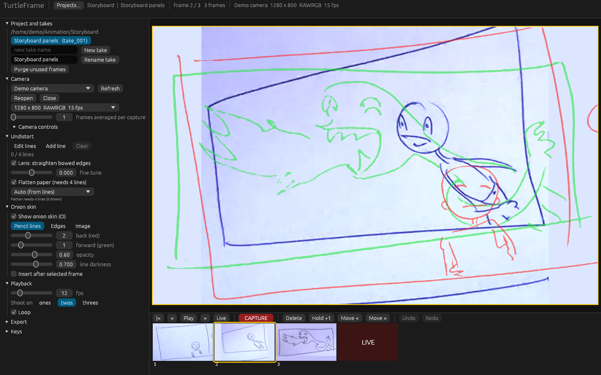
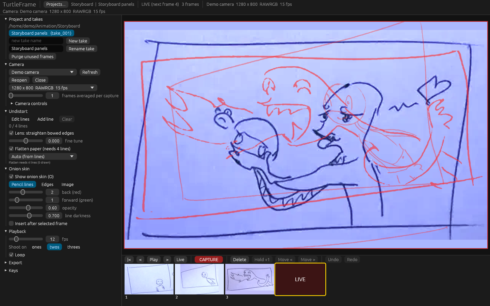
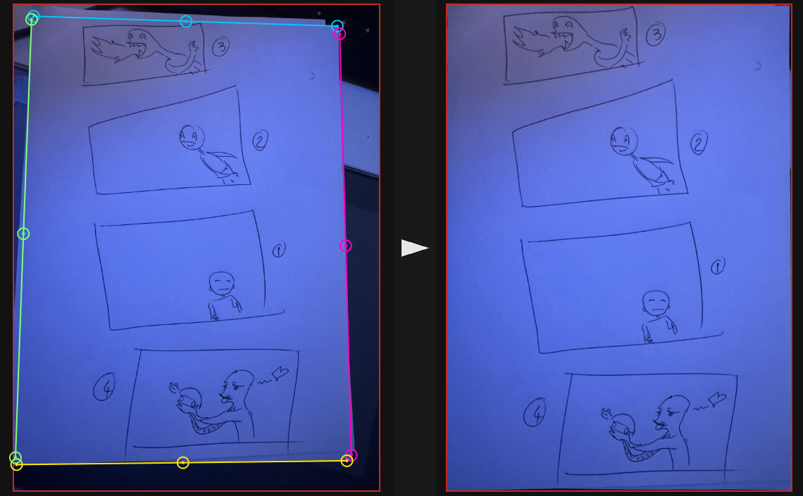

# TurtleFrame

Pencil test and stop motion capture. Stills only, no sound, no video.



Live view about to capture panel 4, previous frames in red:



Undistort on a phone photo of a storyboard page, 4 lines then flattened to A-series paper:



## Build

No libclang or system dev packages needed: the Linux v4l2 bindings are pre-generated for x86_64, aarch64 and 32-bit ARM (`vendor/v4l2-sys-mit`). One executable.

```sh
cargo build --release
```

Binary: `target/release/turtleframe` (`turtleframe.exe` on Windows).

- Linux: runs on X11 and Wayland. Needs a webcam the kernel sees as `/dev/video*` and read access to it (user in the `video` group).
- macOS: run it from Terminal the first time; macOS asks for camera permission for Terminal. A bare binary moved into an `.app` bundle needs `NSCameraUsageDescription` in its `Info.plist`.
- Windows: uses Media Foundation. No console window in release builds.

## Downloads and automatic builds

Every push to `main` builds all platforms in GitHub Actions and replaces the `latest` pre-release on the Releases page with the new archives. Pushing a tag such as `v0.2.0` creates a normal versioned Release.

| Archive | Runs on |
|---|---|
| `linux-x86_64` | 64-bit PC Linux |
| `windows-x86_64` | Windows 10/11 |
| `macos-arm64` | Apple Silicon Macs |
| `macos-x86_64` | Intel Macs |
| `pi-aarch64` | Raspberry Pi 3, 4, 5, Zero 2 W with 64-bit Pi OS |
| `pi-armv7` | Raspberry Pi 2, 3 with 32-bit Pi OS |
| `pi-armv6` | Raspberry Pi 1, Zero, Zero W |

macOS builds are unsigned: after unpacking run `xattr -d com.apple.quarantine turtleframe` once.

Raspberry Pi notes: USB webcams only (CSI ribbon cameras use libcamera, not supported). On a Pi 1 or Zero pick a 640x480 or 720p format for a responsive live view. The in-memory preview cache scales with system RAM.

Cross-compiling a Pi build yourself (needs Docker):

```sh
cargo install cross && cross build --release --target arm-unknown-linux-gnueabihf
```

Targets: `arm-unknown-linux-gnueabihf` (Pi 1/Zero), `armv7-unknown-linux-gnueabihf` (Pi 2/3, 32-bit), `aarch64-unknown-linux-gnu` (64-bit Pi OS).

## Projects

A project is a folder. `Projects...` opens a folder browser; any folder can be used, and becomes a project the first time.

```
MyProject/
  turtleframe.project              project marker, saved camera controls
  takes/take_001/take.txt          name, fps, twos/threes, undistort lines
  takes/take_001/sequence.txt      frame order (one id per line)
  takes/take_001/frames/*.png      raw full resolution captures (never altered)
  takes/take_001/frames/preview/   small JPEGs for fast playback
  takes/take_001/trash/            frames moved out by "Purge unused frames"
  export/take_001/*.png            corrected PNG sequence
```

Each take has its own history and undistort settings. A new take copies fps and undistort from the current one. Frames are captured raw; undistort is applied on display and on export, so lines can be changed at any time.

Deleting a frame only removes it from the sequence (undo works across it). "Purge unused frames" moves unreferenced files into the take's `trash/`.

## Camera

Picks the highest resolution the device reports. At that resolution it prefers an uncompressed format if it still runs at 10 fps or more, otherwise the fastest one. The format list lets you choose another. "Frames averaged per capture" averages several frames into one still to reduce noise.

Camera controls are listed as the driver exposes them. Nothing is changed unless you touch a control, so the camera stays on its automatic defaults. "Save to project" stores the current values; "Apply saved" restores them.

## Undistort

1. Undistort > `Add line`, then drag along a paper edge, corner to corner. Repeat for up to 4 edges.
2. Each line has a start, middle and end handle. Drag the middle handle onto the bowed edge. A magnifier shows while dragging.
3. Right-click a handle to delete its line.

- 1 to 4 lines: lens bow is solved so those edges come out straight (`fine tune` adjusts it by hand).
- 4 lines with `Flatten paper`: the four edges are intersected into the sheet's corners and warped to a flat rectangle. Pick the paper ratio (A-series, Letter, 16:9 field, 4:3 field, custom) or leave it on Auto.

## Onion skin

Red is back, green is forward. Up to 5 each, fading with distance.

- `Pencil lines`: dark strokes relative to the surrounding paper.
- `Edges`: Sobel edge detect.
- `Image`: the whole frame as a tinted ghost (darker = stronger).

In live view the onion is anchored at the insert point. With `Insert after selected frame` on, captures go after the last selected frame and green shows the frames after it.

## Keys

| Key | Action |
|---|---|
| Space | capture |
| Enter | play / stop |
| Left / Right | step |
| Home / End | first frame / live |
| Delete, Backspace | remove frame (in live: the last frame) |
| T | flip between live and last frame |
| L | live |
| O | onion on / off |
| Ctrl+Z, Ctrl+Shift+Z (Cmd on macOS) | undo / redo frame edits |
| Esc | stop playback, cancel adding lines |

## Tests

```sh
cargo test
```

Covers lens k recovery from synthetically bent lines, quad flattening, MJPEG streams without Huffman tables, and project save/load.
